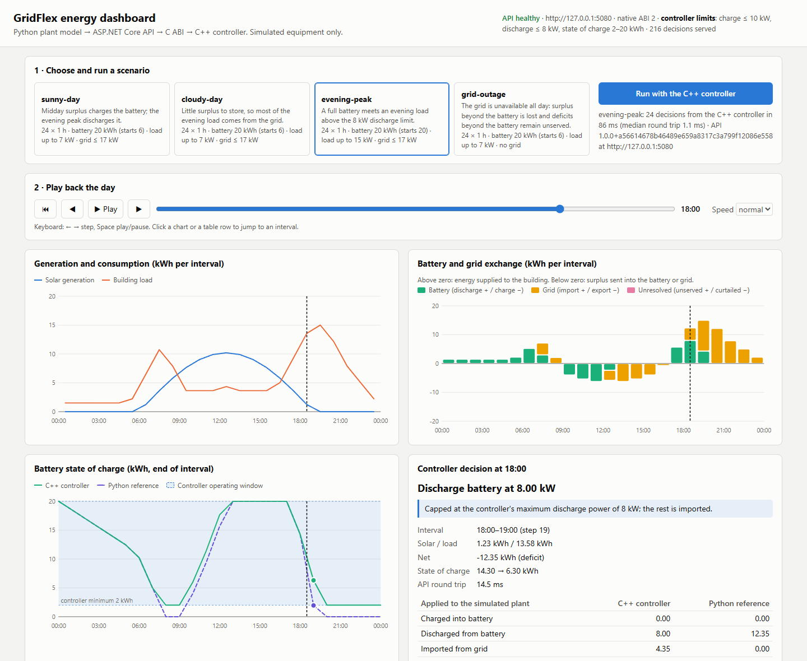
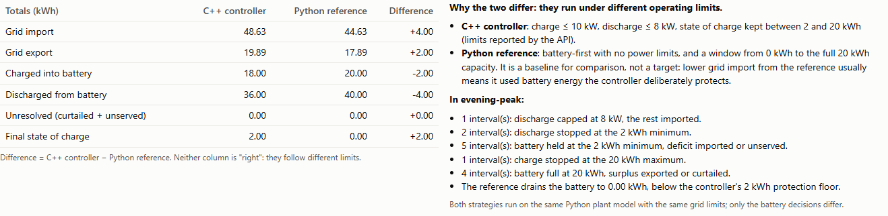
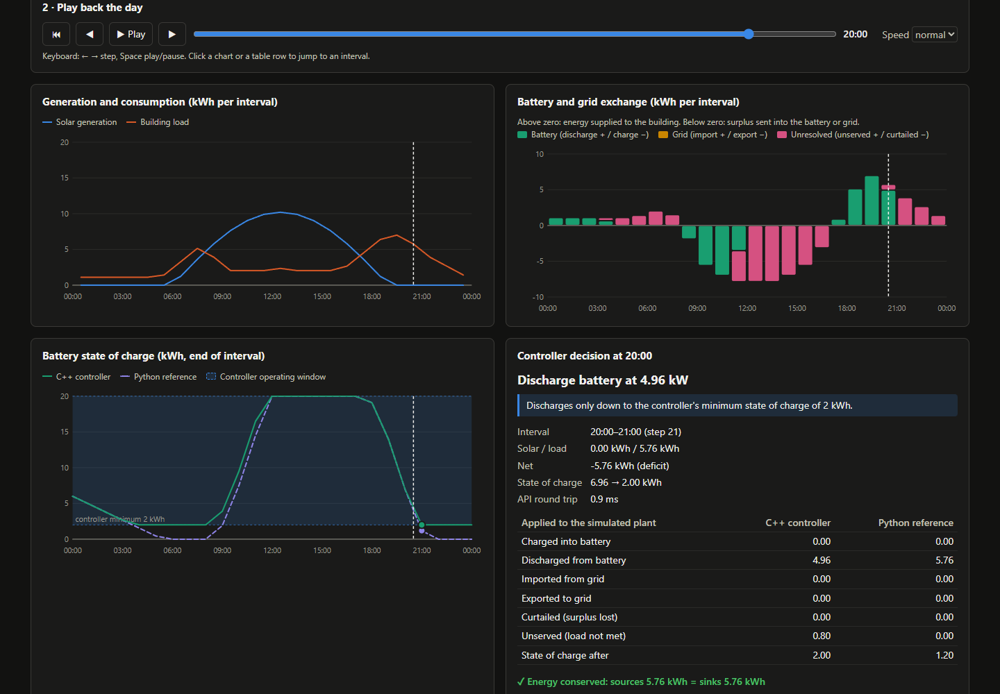

# Interactive energy dashboard

`gridflex-dashboard` is a local web dashboard for the
[software-in-the-loop](software-in-the-loop.md) path. You pick a scenario, run
it with the **real C++ controller** deciding every interval, and then play the
day back interval by interval. For each interval you can see what the
controller was asked, what it answered, which limit determined the answer, and
what the Python battery-first reference did instead.



Only simulated equipment is involved. The decisions are applied to Python
battery and grid objects, never to real hardware.

## How a run travels

```text
Browser ──POST /api/runs──▶ gridflex-dashboard (Python plant model)
                                 │  for every interval
                                 ├──POST /api/control/decision──▶ ASP.NET Core API
                                 │                                  │ C# gateway, LibraryImport
                                 │                                  ▼ versioned C ABI
                                 │                                C++ EnergyController
                                 ◀──────────── decision ────────────┘
                                 │  apply to simulated battery and grid
                                 └─ run the Python reference on the same scenario
Browser ◀── one JSON document: every interval, both strategies, explanations
```

The browser never calls the GridFlex API itself. The dashboard server **is**
the Python plant model: it reuses `ControllerInTheLoopRunner`, the same code
`gridflex-sil` and the CI workflow use. No control logic is duplicated in
JavaScript or in the dashboard.

| Piece | File | Responsibility |
|---|---|---|
| Application layer | [`dashboard.py`](../simulation/src/gridflex_simulation/dashboard.py) | `DashboardService` lists scenarios, reads the API status and runs a scenario. `RecordingDecisionProvider` wraps the API client and records the exact request, the response and the round-trip time of every interval. `explain_decision` traces a decision to a limit. `run_to_dict` builds the JSON document. |
| HTTP layer | [`dashboard_server.py`](../simulation/src/gridflex_simulation/dashboard_server.py) | Standard-library `ThreadingHTTPServer`: three JSON endpoints, an allow-list of static files, problem-details errors and security headers. Listens on `127.0.0.1` by default. |
| Page | [`dashboard_static/`](../simulation/src/gridflex_simulation/dashboard_static/) | Plain HTML, CSS and an ES module with SVG charts. No build step, no external resources and no framework. |

The package still has **no runtime dependencies**.

### Endpoints

| Method and path | Result |
|---|---|
| `GET /api/scenarios` | The scenario catalogue with summary, battery, solar, building and grid parameters |
| `GET /api/controller` | `{apiUrl, reachable, status}`; `status` is the API's `/api/system/status` (health, ABI version, controller limits, decision counters) |
| `POST /api/runs` with `{"scenario": "evening-peak"}` | The run document described below |

Errors are `application/problem+json`: 400 for a malformed body, 404 for an
unknown scenario or path, 405 for `GET /api/runs`, 415 when the body is not
JSON, and **502** when the GridFlex API is unreachable or rejects a
measurement (the upstream error is passed on in `detail`).

### The run document

For every interval, `controller.steps[i]` holds:

- `request`: the exact JSON body sent to `POST /api/control/decision`;
- `response`: the decision that came back (`sourceStepNumber`, `action`,
  `requestedPowerKw`) and `roundTripMs`;
- the energy applied to the simulated plant: charged, discharged, imported,
  exported, curtailed, unserved, and the state of charge before and after;
- `explanation`: `{code, text}` (see below).

`reference.steps[i]` holds the same energy flows for the Python battery-first
reference, and both sides carry totals. `controllerLimits` are the limits the
API reported; `referenceLimits` are the reference's (no power limits, 0 kWh to
full capacity).

## What the page shows

1. **Scenario selection and execution.** Four 24-hour scenarios
   (`sunny-day`, `cloudy-day`, `evening-peak`, `grid-outage`). The header
   shows the API's health, native ABI version, controller limits and how many
   decisions it has served.
2. **Energy-flow charts.** Solar generation and building load per interval;
   a diverging column chart of the battery, the grid and unresolved energy
   (above zero: energy supplied to the building; below zero: surplus sent
   into the battery or the grid, or curtailed).
3. **Battery state.** The state of charge of the C++ controller and of the
   Python reference at every interval boundary, with the controller's
   operating window shaded.
4. **Playback.** Play, pause, step, a slider and three speeds. A cursor
   moves through all charts. Keyboard: ← and → step, Space plays or pauses.
   Clicking a chart or a table row jumps to that interval.
5. **Decision inspection.** For the current interval: the decision, the limit
   that determined it, the inputs, the energy applied to the plant by both
   strategies side by side, the energy-conservation check, and the raw request
   and response.
6. **Comparison.** Totals for both strategies with their difference, and a
   data-driven explanation of the operating limits (below).
7. **Every decision** in a table, which also serves as the accessible text
   alternative to the charts.

## Why the C++ controller and the Python reference differ

They run on the same plant model, the same scenario and the same grid limits.
Only the battery decisions differ, because they follow different operating
limits:

| | C++ controller (via the API) | Python reference |
|---|---|---|
| Charge power | ≤ 10 kW (default `NativeController` options) | unlimited |
| Discharge power | ≤ 8 kW | unlimited |
| State of charge | kept between 2 and 20 kWh | 0 kWh to full capacity (20 kWh) |

The limits on the left are not hard-coded in the dashboard: they are read from
`/api/system/status` on every run, so a backend configured with other limits
is explained with its own values.

The reference therefore usually imports **less** from the grid: it uses the
2 kWh the controller deliberately keeps in reserve, and it discharges above
8 kW in an evening peak. Lower import from the reference is not a sign that
the controller is wrong; it is the cost of protecting the battery. The page
lists, per scenario, how many intervals each limit applied and whether the
reference left the controller's window.



## How a decision is explained

`EnergyController::decide` takes the minimum of three powers. For a surplus:
the power that stores the whole surplus, the maximum charge power, and the
power that reaches the maximum state of charge. For a deficit: the power that
supplies the whole deficit, the maximum discharge power, and the power that
reaches the minimum state of charge.

`explain_decision` recomputes those three candidates from the measurement and
the **reported** limits, and names the one that equals the returned power:

| Code | Meaning |
|---|---|
| `covers-surplus` / `covers-deficit` | The battery takes or supplies everything |
| `max-charge-power` / `max-discharge-power` | Capped by the power limit; the rest goes to or comes from the grid |
| `soc-maximum` / `soc-minimum` | Stopped at the state-of-charge limit |
| `battery-full` / `battery-at-minimum` | Idle because the battery is already at the limit |
| `balanced` | Generation equals consumption |
| `limits-unknown` | The API did not report its limits |
| `unexplained` | The decision does not follow from the reported limits |

This is an **explanation for display, derived in Python**. It never changes a
decision, and the C++ controller does not send a reason across the C ABI. If
the controller and the reported limits ever disagree, the interval is shown
as `unexplained` instead of being given a plausible-looking reason. The CI
smoke test fails if any interval of any scenario is `unexplained` against the
real controller.

## Run it locally

You need the GridFlex API with the native controller, and Python 3.12+.

**1. Start the API** (pick one):

```bash
# Published container image (Docker)
docker run --rm -p 5080:8080 ghcr.io/kris7011/gridflex-ems-backend:latest
```

```powershell
# Windows without Docker, from an "x64 Native Tools" prompt for Visual Studio
# (CMake and Ninja can come from `python -m pip install cmake ninja`).
cmake -S controller -B controller/build -G Ninja -DCMAKE_BUILD_TYPE=Release -DBUILD_TESTING=OFF -DGRIDFLEX_BUILD_BENCHMARKS=OFF
cmake --build controller/build --target gridflex_controller_native
cmake --install controller/build --prefix controller/package --component runtime
$env:PATH = "$PWD\controller\package\bin;$env:PATH"
dotnet run --project backend/GridFlex.Api --no-launch-profile --urls http://127.0.0.1:5080
```

On Linux, install to `controller/package` the same way and set
`LD_LIBRARY_PATH=controller/package/lib` instead of `PATH`.

**2. Start the dashboard:**

```bash
cd simulation
python -m pip install -e .
gridflex-dashboard --api-url http://127.0.0.1:5080
```

**3. Open** <http://127.0.0.1:8050>, choose a scenario and select
**Run with the C++ controller**. `http://127.0.0.1:8050/#grid-outage`
preselects a scenario.

Options: `--port` (default 8050) and `--host` (default `127.0.0.1`; only
change it on a trusted network, since the dashboard has no authentication).



## Tests

- [`tests/test_dashboard.py`](../simulation/tests/test_dashboard.py):
  every explanation code, power-versus-energy for a half-hour interval,
  decisions that contradict the limits, missing or malformed limits, the
  recorded request contract and round-trip time, a run of every scenario
  with no unexplained interval, the 18:00 discharge cap in `evening-peak`,
  reference totals and per-interval energy conservation, the reference
  leaving the controller window, a run without status, an unknown scenario
  (no API call is made) and an API failure.
- [`tests/test_dashboard_server.py`](../simulation/tests/test_dashboard_server.py):
  a real HTTP server on a free port: content types and security headers,
  that only allow-listed paths are served, the JSON endpoints, a full run,
  405/400/415/404/502 problem details, and that the page loads nothing from
  other origins and never parses server text as HTML.
- These tests use `FakeController`, a stand-in that mirrors
  `EnergyController::decide`. The **Software in the Loop** workflow runs the
  dashboard against the real backend container and fails if any interval of
  any scenario is unexplained.

Not automated: the browser behaviour (charts, playback, keyboard). It was
checked manually in Microsoft Edge against the real API, in light and dark
mode and at phone width (390 px), which is where the screenshots come from.

## Limitations

- It visualises **simulated runs**, not live operation: there is no live
  telemetry, no alerting and no persisted history of past runs.
- A run is synchronous (24 API calls, typically under 150 ms locally); a much
  longer scenario would need streaming or a background job.
- No authentication. It binds to `127.0.0.1` by default for that reason.
- The explanation covers the controller's current decision rule. A future
  controller strategy that also uses grid import or export actions would need
  new explanation codes (until then they show as `unexplained`).
